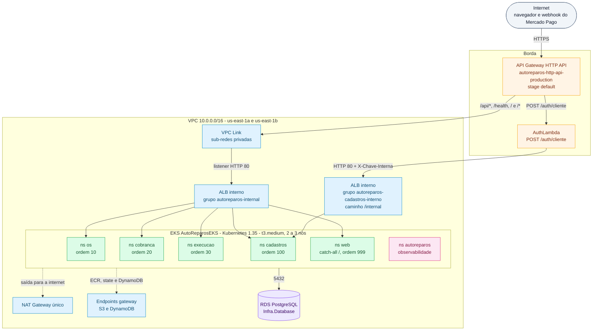
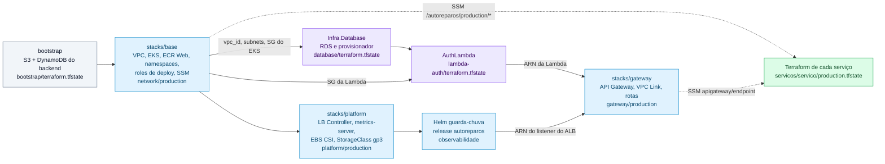
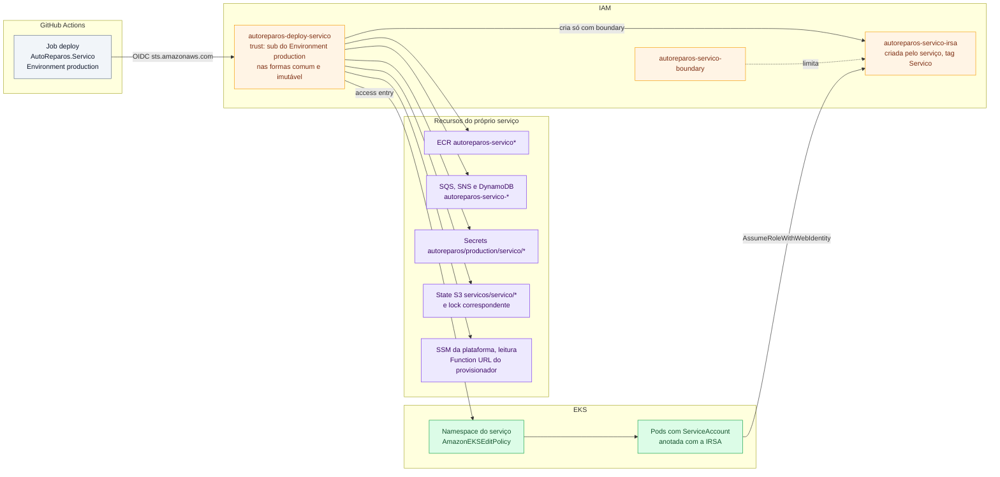
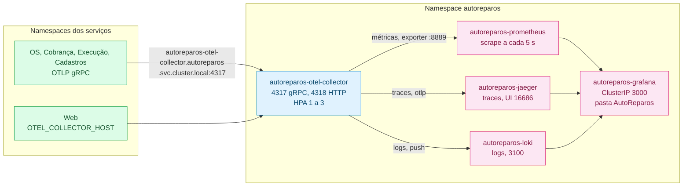
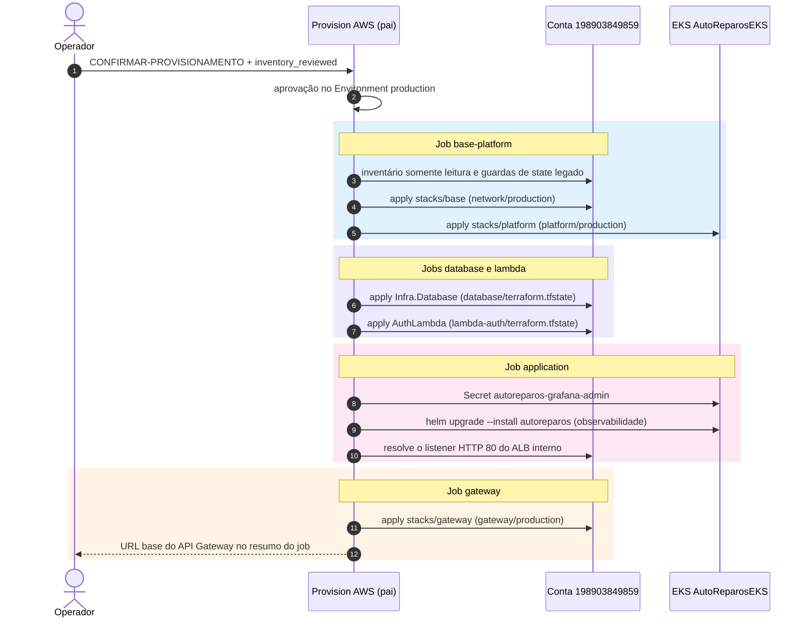

# AutoReparos.Infra.K8s

> Plataforma compartilhada do AutoReparos na AWS: **rede, cluster EKS, add-ons, API Gateway, acesso de deploy por microsserviço e stack de observabilidade**. Cada microsserviço traz o próprio chart, ECR, filas e banco; este repositório entrega o chão onde eles rodam.

[](https://github.com/Grupo78-PosTech-15SOAT/AutoReparos.Infra.K8s/actions/workflows/ci.yml)


| | |
|---|---|
| **Projeto** | AutoReparos — Sistema Integrado de Oficina Mecânica |
| **Fase** | Tech Challenge FIAP SOAT — Fase 4 (microsserviços, Saga e CI/CD), Grupo 78 |
| **Papel** | Repositório de plataforma (Terraform + Helm) |
| **Produção** | Conta `198903849859`, região `us-east-1`, cluster EKS `AutoReparosEKS`, API Gateway `https://8afyzjqfk2.execute-api.us-east-1.amazonaws.com` |
| **Repositório pai** | [Grupo78-PosTech-15SOAT/AutoReparos](https://github.com/Grupo78-PosTech-15SOAT/AutoReparos) |

---

## Sumário

1. [Visão geral e papel no ecossistema](#1-visão-geral-e-papel-no-ecossistema)
2. [Arquitetura](#2-arquitetura)
3. [Recursos provisionados (Terraform)](#3-recursos-provisionados-terraform)
4. [Acesso de deploy por microsserviço](#4-acesso-de-deploy-por-microsserviço)
5. [Chart Helm e observabilidade](#5-chart-helm-e-observabilidade)
6. [Estrutura do repositório](#6-estrutura-do-repositório)
7. [Pré-requisitos](#7-pré-requisitos)
8. [Como validar e rodar localmente](#8-como-validar-e-rodar-localmente)
9. [CI/CD e deploy](#9-cicd-e-deploy)
10. [Variáveis, segredos e outputs](#10-variáveis-segredos-e-outputs)
11. [Segurança e custo](#11-segurança-e-custo)
12. [Repositórios relacionados](#12-repositórios-relacionados)

---

## 1. Visão geral e papel no ecossistema

O enunciado da Fase 4 pede microsserviços com **repositório, infraestrutura e banco próprios** e **deploy automatizado em Kubernetes**. O grupo dividiu a infraestrutura em duas camadas ([ADR-005](https://github.com/Grupo78-PosTech-15SOAT/AutoReparos/blob/main/docs/architecture/ADR-005-deploy-independente-por-microsservico.md)):

| Fica aqui (plataforma) | Fica no repositório de cada serviço |
|---|---|
| VPC, NAT, endpoints de S3 e DynamoDB | Chart Helm `deploy/helm/<servico>` (D-43) |
| Cluster EKS, node group, add-ons (Load Balancer Controller, metrics-server, EBS CSI) | ECR `autoreparos-<servico>` (D-42) |
| Namespaces `os`, `cobranca`, `execucao`, `cadastros` e `web` | Filas e DLQs SQS, tópico SNS, tabelas DynamoDB, role IRSA (D-42, D-67) |
| Role OIDC de deploy por repositório e *permissions boundary* das roles IRSA | Segredo da database e chamada ao provisionador do [Infra.Database](https://github.com/Grupo78-PosTech-15SOAT/AutoReparos.Infra.Database) (D-54) |
| API Gateway HTTP, VPC Link e rotas públicas | Ingress com as rotas do serviço no ALB compartilhado |
| Parâmetros SSM `/autoreparos/production/*` lidos pelos serviços (D-53) | Pipeline `ci-cd.yml` com build, testes, qualidade e deploy |
| ECR do Web e security group da AuthLambda | |
| Chart guarda-chuva com a observabilidade (namespace `autoreparos`) | |
| Backend do Terraform ([`bootstrap/`](bootstrap/README.md)) | |

Nada daqui é aplicado por este repositório: o CI só valida, e os workflows do repositório pai são os únicos que escrevem os states da plataforma (D-13, D-45).

---

## 2. Arquitetura

### 2.1 Visão da plataforma em produção



Os dois ALBs são criados pelo **AWS Load Balancer Controller** a partir dos Ingress de cada release. Os Ingress do grupo `autoreparos-internal` se somam no mesmo ALB e são avaliados pela `group.order`: OS (10), Cobrança (20), Execução (30), Cadastros (100) e o catch-all `/` do Web (999). O ALB `autoreparos-cadastros-interno` não está ligado ao API Gateway, então `/internal` não é alcançável da internet.

### 2.2 Rotas do API Gateway

| Rota | Integração | Destino |
|---|---|---|
| `POST /auth/cliente` | `AWS_PROXY`, payload 1.0 | Lambda `autoreparos-auth-lambda-production` |
| `ANY /api/{proxy+}` | `HTTP_PROXY` por VPC Link | Listener do ALB `autoreparos-internal` |
| `GET /health` | `HTTP_PROXY` por VPC Link | Listener do ALB `autoreparos-internal` |
| `ANY /` e `ANY /{proxy+}` | `HTTP_PROXY` por VPC Link | Listener do ALB (Web e deep links do Angular) |

O stage `$default` tem `auto_deploy`, CORS aberto (`*`, métodos `GET`, `POST`, `PUT`, `DELETE`, `OPTIONS`, `PATCH`) e log de acesso em `/aws/apigateway/autoreparos-http-api-production` (7 dias). O webhook do Mercado Pago entra por `/api/v1/webhooks/mercado-pago`, coberto por `/api/{proxy+}`.

### 2.3 Stacks do Terraform e ordem de aplicação



Os serviços não usam `terraform_remote_state`: leem cluster, provedor OIDC, RDS e API Gateway pelos parâmetros SSM que a plataforma publica (D-53).

---

## 3. Recursos provisionados (Terraform)

### 3.1 `terraform/stacks/base` — rede, cluster e acesso

| Recurso | Detalhes |
|---|---|
| VPC (`modules/vpc`) | `10.0.0.0/16`; sub-redes públicas `10.0.1.0/24` e `10.0.2.0/24`, privadas `10.0.3.0/24` e `10.0.4.0/24` em `us-east-1a`/`us-east-1b`; tags `kubernetes.io/role/elb` e `internal-elb` para o Load Balancer Controller |
| Saída | Internet Gateway; **um** NAT Gateway com Elastic IP; endpoints do tipo gateway de S3 e DynamoDB na tabela de rota privada (D-55) |
| Cluster (`modules/eks`) | EKS 1.35 em sub-redes privadas; endpoint público e privado; secrets cifrados com KMS (rotação ligada); logs `api`, `audit`, `authenticator`, `controllerManager` e `scheduler`; autenticação `API_AND_CONFIG_MAP` |
| Node group | `t3.medium`, mínimo 2, desejado 2, máximo 3 (D-44); políticas de worker, CNI, leitura do ECR e EBS CSI |
| Provedor OIDC do cluster | Base da IRSA dos add-ons e dos serviços |
| ECR (`modules/ecr`) | `autoreparos-web`, com *scan on push* |
| Security group da AuthLambda | `autoreparos-auth-lambda-sg-production`: saída 443, e 80 e 5432 dentro da VPC |
| Namespaces | `os`, `cobranca`, `execucao`, `cadastros` e `web`, com rótulo `app.kubernetes.io/part-of=autoreparos` |
| Roles de deploy | `autoreparos-deploy-{os,cobranca,execucao,cadastros}` e `autoreparos-deploy-web` (seção 4) |
| Boundary | `autoreparos-servico-boundary`, teto das roles IRSA criadas pelos serviços |
| Acesso humano | *Access entry* `AmazonEKSClusterAdminPolicy` para o permission set de administrador do Identity Center |
| SSM | `/autoreparos/production/{vpc_id, subnets/private, security-groups/eks-nodes, eks/cluster_name, eks/oidc_provider_arn, eks/oidc_provider_url}` |

### 3.2 `terraform/stacks/platform` — add-ons do cluster

| Recurso | Detalhes |
|---|---|
| AWS Load Balancer Controller | Chart `aws-load-balancer-controller` 1.14.0 em `kube-system`, ServiceAccount com IRSA e política IAM própria |
| metrics-server | Chart 3.12.2 (base do HPA dos serviços e do OTel Collector) |
| EBS CSI | Add-on gerenciado `aws-ebs-csi-driver` com IRSA |
| StorageClass | `gp3`, `WaitForFirstConsumer`, `Retain` |

### 3.3 `terraform/stacks/gateway` — borda

| Recurso | Detalhes |
|---|---|
| API Gateway HTTP | `autoreparos-http-api-production`, rotas da seção 2.2 |
| VPC Link | `autoreparos-vpc-link-production` nas sub-redes privadas, com SG próprio |
| Permissão da Lambda | `lambda:InvokeFunction` para o API Gateway |
| SSM | `/autoreparos/production/apigateway/endpoint`, usado pelos serviços como emissor e `Authority` do JWT |

### 3.4 Raiz legada `terraform/`

A raiz `terraform/` (state `k8s/terraform.tfstate`) é o desenho único da Fase 3 e está **congelada**: não aplique. O workflow `Provision AWS` aborta se esse state ainda contiver recursos ou se encontrar VPC, cluster ou ECR homônimos sem o state novo. Os módulos em `terraform/modules/` são compartilhados com os stacks.

---

## 4. Acesso de deploy por microsserviço

Cada repositório de serviço implanta a si mesmo, com uma identidade que só alcança os próprios recursos (AD-053, D-61).



| Controle | Implementação ([`servicos.tf`](terraform/stacks/base/servicos.tf), [`politicas/`](terraform/stacks/base/politicas)) |
|---|---|
| Quem assume | Só o Environment `production` do repositório `AutoReparos.<Servico>`, nas duas formas do `sub` do OIDC do GitHub (com nomes e com ids numéricos da organização e do repositório) |
| O que a role de deploy acessa | Recursos com prefixo `autoreparos-<servico>`; state em `servicos/<servico>/*`; SSM não secreto da plataforma; `eks:DescribeCluster`; invocar o provisionador só pela Function URL; assinar tópicos SNS de outros serviços |
| Criação de roles | Só `autoreparos-<servico>-*`, só com o boundary e com a tag `Servico` igual ao próprio serviço; a tag não pode ser removida nem trocada; `sts:TagSession` negado |
| Boundary das roles IRSA | Publicar em qualquer fila `autoreparos-*`; consumir, publicar em SNS, usar DynamoDB e ler segredos só com o prefixo da tag `Servico` da role |
| Kubernetes | *Access entry* com `AmazonEKSEditPolicy` limitada ao namespace do serviço |
| Web | `autoreparos-deploy-web`: só ECR `autoreparos-web`, `eks:DescribeCluster` e edição do namespace `web`; sem SQS, SNS, DynamoDB, Secrets Manager ou IAM (D-72) |

O provedor OIDC do GitHub já existe na conta e é só lido pelo Terraform.

---

## 5. Chart Helm e observabilidade

### 5.1 Chart guarda-chuva `k8s/`

| Subchart | Condição | Produção (`values-production.yaml`) | Conteúdo |
|---|---|---|---|
| `observability` | sempre | **ligado**, namespace `autoreparos` | OTel Collector, Prometheus, Jaeger, Loki e Grafana |
| `web` | `web.enabled` | **desligado**: o Web tem release próprio no namespace `web` (D-72) | Deployment, Service e o Ingress `autoreparos-web-ingress` (grupo `autoreparos-internal`, ordem 1000) para uso local |
| `database` | `database.enabled` | **desligado**: produção usa o RDS | StatefulSet PostgreSQL 16 com PV `hostPath`, para cluster local |

Em produção o release `autoreparos` renderiza 5 Deployments, 5 Services, 7 ConfigMaps e 1 HPA, todos da observabilidade. Os charts dos serviços ficam nos repositórios deles.

### 5.2 Pipeline de telemetria



| Componente | Imagem | Detalhes |
|---|---|---|
| OTel Collector | `otel/opentelemetry-collector-contrib:0.96.0` | Receptores OTLP; processadores `memory_limiter`, `resource` e `batch`; exporta traces ao Jaeger, métricas ao Prometheus (namespace de métricas `autoreparos`) e logs ao Loki. Exportação adicional para New Relic ou Datadog por `otelCollector.vendor.enabled` (desligada) |
| Prometheus | `prom/prometheus:v2.51.0` | Coleta o exporter do Collector |
| Jaeger | `jaegertracing/all-in-one:1.55` | Recebe OTLP na 4317; UI na 16686 |
| Loki | `grafana/loki:2.9.5` | API na 3100 |
| Grafana | `grafana/grafana:10.4.1` | Usuário `admin`, senha do Secret `autoreparos-grafana-admin` (chave `admin-password`); servido em `/grafana/`; datasources `Prometheus`, `Jaeger` e `Loki` apontando para os Services reais (D-66) |

Dashboards provisionados na pasta **AutoReparos** do Grafana:

| Dashboard | Painéis |
|---|---|
| **Saga** (D-66) | Sagas iniciadas, concluídas e paradas; mensagens na DLQ da Saga; compensações por passo; link para os traces no Jaeger (tag `ordem_servico.id`) |
| AutoReparos .NET 10 API Overview | Requisições por segundo, latência média, memória, erros 5xx, requisições por rota, logs no Loki |
| AutoReparos - Volume Diário de Ordens de Serviço | Ordens criadas por dia e por hora, volume por status |
| AutoReparos - Tempo Médio por Status da Ordem de Serviço | Tempos de diagnóstico, execução e permanência, p95 por etapa |
| AutoReparos - Erros e Falhas nas Integrações | Falhas de notificação, 5xx por rota, taxa de erro, latência de banco e de chamadas HTTP |

Todos os Services são `ClusterIP`: Grafana, Jaeger e Prometheus não ganham load balancer público. Acesso por *port-forward*:

```bash
aws eks update-kubeconfig --name AutoReparosEKS --region us-east-1
kubectl -n autoreparos port-forward svc/autoreparos-grafana 3000:3000   # http://localhost:3000/grafana/
kubectl -n autoreparos port-forward svc/autoreparos-jaeger 16686:16686  # http://localhost:16686
```

---

## 6. Estrutura do repositório

```text
AutoReparos.Infra.K8s/
├── .github/workflows/ci.yml           # CI: fmt, init -backend=false e validate em toda raiz; helm lint e template
├── bootstrap/                         # backend do Terraform (S3 + DynamoDB) - ver bootstrap/README.md
├── terraform/
│   ├── stacks/
│   │   ├── base/                      # VPC, EKS, ECR Web, SG da Lambda, namespaces, roles de deploy, SSM
│   │   │   ├── servicos.tf · ssm.tf · main.tf · providers.tf · variables.tf · outputs.tf
│   │   │   ├── politicas/             # deploy-servico, deploy-web e servico-boundary (JSON templates)
│   │   │   └── tests/                 # terraform test com mock_provider
│   │   ├── platform/                  # Load Balancer Controller, metrics-server, EBS CSI, gp3
│   │   └── gateway/                   # API Gateway HTTP, VPC Link, rotas, SSM do endpoint
│   ├── modules/                       # vpc, eks, ecr, addons, apigateway
│   └── main.tf · ...                  # raiz legada da Fase 3 (congelada)
├── k8s/
│   ├── Chart.yaml                     # guarda-chuva: database, web, observability
│   ├── values.yaml                    # padrão local
│   ├── values-production.yaml         # produção: só observabilidade
│   ├── templates/ingress.yaml         # Ingress do Web, só com web.enabled
│   ├── charts/{database,web,observability}/
│   └── k8s_architecture_spec.md       # especificação da migração para OpenTelemetry (Fase 3)
└── docker-compose.yml                 # imagens da observabilidade para teste local
```

---

## 7. Pré-requisitos

| Ferramenta | Versão | Para quê |
|---|---|---|
| Terraform | ≥ 1.10 nos stacks (o CI e o pai usam 1.10.5) | validar e testar |
| Helm | 3 (o CI usa v3.16.4) | lint, template e instalação |
| AWS CLI v2 e `kubectl` | — | operar o cluster de produção |
| Docker | opcional | observabilidade local |

---

## 8. Como validar e rodar localmente

### 8.1 Validação (mesma do CI, sem credenciais AWS)

```bash
for dir in terraform/stacks/base terraform/stacks/platform terraform/stacks/gateway bootstrap; do
  terraform -chdir="$dir" fmt -check -recursive
  terraform -chdir="$dir" init -backend=false -input=false
  terraform -chdir="$dir" validate
done

helm lint k8s/
helm template autoreparos k8s/ --namespace autoreparos -f k8s/values-production.yaml
for chart in k8s/charts/*; do helm lint "$chart"; done
```

### 8.2 Testes do Terraform (provedores simulados)

```bash
terraform -chdir=terraform/stacks/base init -backend=false
terraform -chdir=terraform/stacks/base test
```

| Arquivo | O que prova |
|---|---|
| `roles-deploy.tftest.hcl` | 4 namespaces, boundary com `aws:PrincipalTag/Servico`, 4 roles com trust restrito ao Environment `production`, SNS só no prefixo do serviço, access entry limitada ao namespace |
| `web-deploy.tftest.hcl` | Namespace `web`, role `autoreparos-deploy-web` com política mínima e edição só no namespace `web` |
| `vpc-endpoints.tftest.hcl` | Endpoints gateway de S3 e DynamoDB na rota privada e exatamente um NAT Gateway |
| `auth-lambda-rede.tftest.hcl` | Saída HTTP 80 da AuthLambda para o ALB interno do Cadastros, restrita à VPC |

Os quatro arquivos passaram em 17/11/2026.

### 8.3 Chart em um cluster local (Docker Desktop, kind)

```bash
kubectl create namespace autoreparos
kubectl -n autoreparos create secret generic autoreparos-grafana-admin --from-literal=admin-password='<senha local>'
helm upgrade --install autoreparos k8s/ -n autoreparos -f k8s/values.yaml \
  --set database.password='<senha local>'
```

Com `values.yaml`, o guarda-chuva sobe também o Web (imagem `autoreparos-web:latest`) e o PostgreSQL local.

### 8.4 Observabilidade com Docker Compose

```bash
docker compose up -d
# Grafana http://localhost:3000 · Jaeger http://localhost:16686 · Prometheus http://localhost:9090
# Loki http://localhost:3100 · OTLP gRPC 4317 e HTTP 4318
docker compose down
```

O compose sobe as mesmas imagens e versões do chart, sem os ConfigMaps (pipeline do Collector, scrape do Prometheus, datasources e dashboards do Grafana). Para o ambiente local completo, com os serviços, use o `docker-compose.yml` do repositório pai.

---

## 9. CI/CD e deploy

### 9.1 CI deste repositório

[`ci.yml`](.github/workflows/ci.yml) roda em push e pull request para `main` e `develop` quando mudam `terraform/**`, `k8s/**`, `bootstrap/**` ou o próprio workflow:

1. em toda raiz Terraform encontrada (`terraform/**` e `bootstrap/`): `fmt -check -recursive`, `init -backend=false`, `validate`;
2. `helm lint` e `helm template` do guarda-chuva com os valores de produção e de cada subchart.

A `main` é protegida: exige pull request (regra também aplicada a administradores e com descarte de aprovações antigas).

### 9.2 Deploy pelo repositório pai

Os workflows ficam no [repositório pai](https://github.com/Grupo78-PosTech-15SOAT/AutoReparos/tree/main/.github/workflows), todos manuais (`workflow_dispatch`), com OIDC, Environment protegido, conferência da conta (`AWS_ACCOUNT_ID`) e o mesmo grupo de concorrência, para dois deles nunca rodarem juntos. Eles fazem checkout dos submódulos nos commits registrados no pai.



| Workflow do pai | Confirmação | O que faz com este repositório |
|---|---|---|
| `Bootstrap AWS Terraform backend` | `CONFIRMAR-BOOTSTRAP` + `existing_resources_reviewed` (Environment `aws-bootstrap`, só na `main`) | Cria ou recupera o backend em [`bootstrap/`](bootstrap/README.md) |
| `Provision AWS` | `CONFIRMAR-PROVISIONAMENTO` + `inventory_reviewed` | Ordem: `base-platform` → `database` → `lambda` → `application` → `gateway` (diagrama acima) |
| `Deploy application` | `DEPLOY-PRODUCTION` | Atualiza a AuthLambda, recria o Secret do Grafana e faz `helm upgrade --install autoreparos` com `values.yaml` e `values-production.yaml` (observabilidade) |
| `Teardown AWS` | `CONFIRMAR-DESTRUICAO`; `delete_database` + `DELETE-RDS-DATA`; `delete_network` + `DELETE-NETWORK` | Remove gateway; desinstala os releases `os`, `cobranca`, `execucao`, `cadastros`, `web` e `autoreparos` e espera os ALBs sumirem; destrói os stacks dos serviços, a Lambda e `stacks/platform`; opcionalmente o RDS (com snapshot final) e, por último, `stacks/base`. O backend S3 é mantido |

Os microsserviços e o Web **não** são implantados por esses workflows: cada um tem o próprio `ci-cd.yml`, disparado por push na `main` com aprovação no Environment `production` (D-41, D-45, D-72).

**States no backend** (bucket `autoreparos-tfstate-198903849859`, lock `autoreparos-terraform-locks`):

| Chave | Dono |
|---|---|
| `bootstrap/terraform.tfstate` | `bootstrap/` |
| `network/production/terraform.tfstate` | `terraform/stacks/base` |
| `platform/production/terraform.tfstate` | `terraform/stacks/platform` |
| `gateway/production/terraform.tfstate` | `terraform/stacks/gateway` |
| `database/terraform.tfstate` | AutoReparos.Infra.Database |
| `lambda-auth/terraform.tfstate` | AutoReparos.AuthLambda |
| `servicos/<servico>/production.tfstate` | Terraform de cada serviço |
| `k8s/terraform.tfstate` | raiz legada, congelada |

---

## 10. Variáveis, segredos e outputs

### 10.1 Variáveis dos stacks

| Stack | Variável | Padrão | Produção |
|---|---|---|---|
| `base` | `aws_region` | obrigatória | `us-east-1` |
| `base` | `cluster_name` | `autoreparos-cluster` | `AutoReparosEKS` (variável `EKS_CLUSTER_NAME`) |
| `base` | `kubernetes_version` | `1.35` | `1.35` |
| `base` | `environment` | `production` | `production` |
| `base` | `vpc_cidr` · `public_subnet_cidrs` · `private_subnet_cidrs` · `availability_zones` | ver seção 3.1 | padrão |
| `base` | `instance_types` · `min_size` · `desired_size` · `max_size` | `["t3.medium"]`, 2, 2, 3 | padrão |
| `base` | `tf_state_bucket` | obrigatória | bucket do backend |
| `base` | `tf_lock_table` | `autoreparos-terraform-locks` | padrão |
| `base` | `github_org` · `github_org_id` · `github_repo_ids` | organização e ids dos repositórios | padrão |
| `base` | `administradores_eks` | permission set de administrador da conta `198903849859` | padrão |
| `platform` | `aws_region`, `cluster_name`, `kubernetes_version`, `vpc_id`, `oidc_provider_arn`, `oidc_provider_url` | obrigatórias | outputs do `base` |
| `gateway` | `aws_region`, `vpc_id`, `private_subnet_ids`, `lambda_function_arn`, `lambda_function_name`, `alb_listener_arn` (validado como ARN de listener) | obrigatórias | outputs do `base`, da Lambda e do ALB |

### 10.2 GitHub (repositório pai)

Só nomes. Os valores são aplicados pelo `scripts/infra/configurar-github.sh` do pai, que guarda os gerados no SSM.

| Nome | Tipo | Uso |
|---|---|---|
| `AWS_ACCOUNT_ID` · `AWS_REGION` | variable | Conferência da conta e região |
| `TF_STATE_BUCKET` · `TF_LOCK_TABLE` | variable | Backend do Terraform |
| `AWS_ROLE_ARN` | variable e secret (Environments `production` e `aws-bootstrap`) | Role da plataforma assumida por OIDC |
| `EKS_CLUSTER_NAME` · `K8S_NAMESPACE` | variable | `AutoReparosEKS` e `autoreparos` |
| `CADASTROS_INTERNAL_URL` | variable (opcional) | URL do Cadastros para a AuthLambda antes do Ingress interno existir |
| `SUBMODULES_APP_ID` · `SUBMODULES_APP_PRIVATE_KEY` | variable · secret | GitHub App do checkout dos submódulos |
| `GRAFANA_ADMIN_PASSWORD` | secret (`production`) | Senha do Grafana, gravada no Secret `autoreparos-grafana-admin` |
| `CHAVE_INTERNA` | secret (`production`) | Chave interna repassada à AuthLambda |

Cada repositório de serviço recebe no próprio Environment `production` a variável `AWS_ROLE_ARN` com a sua role `autoreparos-deploy-<servico>`. Este repositório não tem secrets.

### 10.3 Outputs

| Stack | Outputs |
|---|---|
| `base` | `vpc_id`, `private_subnet_ids`, `public_subnet_ids`, `cluster_name`, `cluster_endpoint`, `cluster_certificate_authority_data`, `cluster_security_group_id`, `oidc_provider_arn`, `oidc_provider_url`, `lambda_security_group_id`, `ecr_web_repository_url`, `deploy_role_arns`, `servico_boundary_arn` |
| `gateway` | `api_gateway_endpoint`, `alb_listener_arn` |
| `bootstrap` | ver [`bootstrap/README.md`](bootstrap/README.md) |

---

## 11. Segurança e custo

| Tema | Decisão |
|---|---|
| Rede | Nós e pods em sub-redes privadas; ALBs internos; entrada pública só pelo API Gateway |
| Rotas internas | `/internal` do Cadastros num ALB separado, fora do VPC Link |
| Identidade | GitHub só por OIDC, sem chave de acesso; uma role por repositório presa ao Environment `production`; IRSA por serviço sob boundary |
| Kubernetes | Access entries por namespace; secrets do etcd cifrados com KMS; logs do control plane ligados |
| Observabilidade | Services `ClusterIP`; senha do Grafana fora do chart, em Secret criado pelo workflow |
| Custo (D-44, D-55) | Um NAT Gateway; endpoints gateway (sem custo) de S3 e DynamoDB para ECR, state e Saga; `t3.medium` com 2 a 3 nós; ambiente destruído pelo `Teardown AWS` após a gravação |

---

## 12. Repositórios relacionados

| Repositório | Papel |
|---|---|
| [AutoReparos](https://github.com/Grupo78-PosTech-15SOAT/AutoReparos) | Pai: submódulos, especificação e workflows da plataforma |
| [AutoReparos.OS](https://github.com/Grupo78-PosTech-15SOAT/AutoReparos.OS) | Ordem de serviço e orquestrador da Saga (namespace `os`) |
| [AutoReparos.Cobranca](https://github.com/Grupo78-PosTech-15SOAT/AutoReparos.Cobranca) | Orçamento e pagamento com Mercado Pago (namespace `cobranca`) |
| [AutoReparos.Execucao](https://github.com/Grupo78-PosTech-15SOAT/AutoReparos.Execucao) | Fila de execução, catálogo e insumos (namespace `execucao`) |
| [AutoReparos.Cadastros](https://github.com/Grupo78-PosTech-15SOAT/AutoReparos.Cadastros) | Clientes, veículos, usuários e emissão do JWT (namespace `cadastros`) |
| [AutoReparos.Web](https://github.com/Grupo78-PosTech-15SOAT/AutoReparos.Web) | Frontend Angular (namespace `web`) |
| [AutoReparos.AuthLambda](https://github.com/Grupo78-PosTech-15SOAT/AutoReparos.AuthLambda) | Autenticação do cliente em `POST /auth/cliente` |
| [AutoReparos.Infra.Database](https://github.com/Grupo78-PosTech-15SOAT/AutoReparos.Infra.Database) | RDS PostgreSQL e provisionador de databases |

Documentação no pai: [ADR-005](https://github.com/Grupo78-PosTech-15SOAT/AutoReparos/blob/main/docs/architecture/ADR-005-deploy-independente-por-microsservico.md) · [spec de infraestrutura e mensageria](https://github.com/Grupo78-PosTech-15SOAT/AutoReparos/blob/main/.specs/features/fase4/especificacao/infraestrutura/fase4_spec_infraestrutura_k8s_e_mensageria.md) · [arquitetura e justificativa](https://github.com/Grupo78-PosTech-15SOAT/AutoReparos/blob/main/docs/entrega/fase4/arquitetura_e_justificativa.md) · [índice de decisões](https://github.com/Grupo78-PosTech-15SOAT/AutoReparos/blob/main/.specs/features/fase4/especificacao/index.md).
