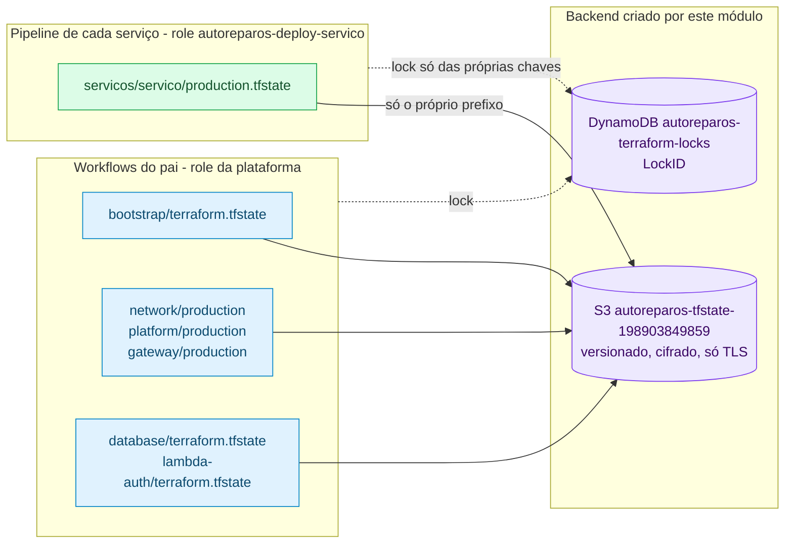
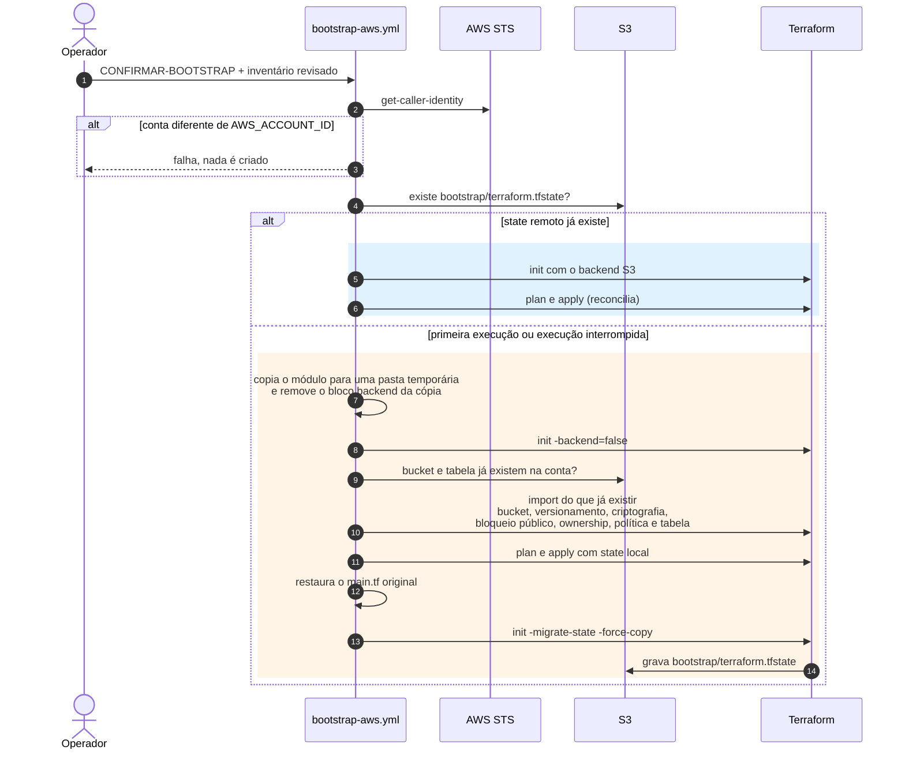

# Bootstrap do backend do Terraform

> Cria o **bucket S3** e a **tabela DynamoDB** que guardam e travam todos os states do Terraform do AutoReparos: plataforma, banco, Lambda e os quatro microsserviços.


Parte do [AutoReparos.Infra.K8s](../README.md) · repositório pai: [Grupo78-PosTech-15SOAT/AutoReparos](https://github.com/Grupo78-PosTech-15SOAT/AutoReparos)

---

## 1. Por que um módulo separado

O Terraform guarda o state num bucket S3 e usa uma tabela DynamoDB para impedir duas execuções simultâneas. Esse bucket e essa tabela não podem ser criados por um Terraform que já depende deles. O `bootstrap/` resolve o problema do ovo e da galinha:

1. na primeira execução, roda com **state local**, cria o bucket e a tabela;
2. em seguida **migra o próprio state** para dentro do bucket recém-criado (`bootstrap/terraform.tfstate`);
3. nas execuções seguintes, já usa o backend remoto como qualquer outro stack.

---

## 2. Recursos provisionados

| Recurso | Nome em produção | Configuração |
|---|---|---|
| `aws_s3_bucket.terraform_state` | `autoreparos-tfstate-198903849859` (variável `TF_STATE_BUCKET`) | `force_destroy = false` e `prevent_destroy` |
| `aws_s3_bucket_versioning` | — | Versionamento ligado: histórico e recuperação de states |
| `aws_s3_bucket_server_side_encryption_configuration` | — | SSE-S3 (`AES256`) |
| `aws_s3_bucket_public_access_block` | — | Os quatro bloqueios de acesso público ligados |
| `aws_s3_bucket_ownership_controls` | — | `BucketOwnerEnforced` (sem ACLs) |
| `aws_s3_bucket_policy.enforce_tls` | — | Nega qualquer `s3:*` sem TLS (`aws:SecureTransport = false`) |
| `aws_dynamodb_table.terraform_locks` | `autoreparos-terraform-locks` (variável `TF_LOCK_TABLE`) | Chave `LockID` (String), `PAY_PER_REQUEST`, PITR e criptografia ligados, `prevent_destroy` |

Tags padrão: `Project = AutoReparos`, `Component = TerraformBootstrap`, `Environment`, `ManagedBy = Terraform`, `Repository`.

---

## 3. Quem usa o backend



| Chave do state | Stack | Repositório |
|---|---|---|
| `bootstrap/terraform.tfstate` | este módulo | AutoReparos.Infra.K8s |
| `network/production/terraform.tfstate` | `terraform/stacks/base` | AutoReparos.Infra.K8s |
| `platform/production/terraform.tfstate` | `terraform/stacks/platform` | AutoReparos.Infra.K8s |
| `gateway/production/terraform.tfstate` | `terraform/stacks/gateway` | AutoReparos.Infra.K8s |
| `database/terraform.tfstate` | `terraform/` | AutoReparos.Infra.Database |
| `lambda-auth/terraform.tfstate` | `infra/` | AutoReparos.AuthLambda |
| `servicos/<servico>/production.tfstate` | `infra/terraform` | OS, Cobrança, Execução e Cadastros |
| `k8s/terraform.tfstate` | raiz legada da Fase 3 (congelada) | AutoReparos.Infra.K8s |

As roles `autoreparos-deploy-<servico>` só leem e gravam objetos em `servicos/<servico>/*` e só travam chaves desse prefixo (condição `dynamodb:LeadingKeys`), conforme a política em [`../terraform/stacks/base/politicas/deploy-servico.json.tftpl`](../terraform/stacks/base/politicas/deploy-servico.json.tftpl).

---

## 4. Como executar

### 4.1 Pelo GitHub Actions (caminho oficial)

Workflow `Bootstrap AWS Terraform backend` ([`bootstrap-aws.yml`](https://github.com/Grupo78-PosTech-15SOAT/AutoReparos/blob/main/.github/workflows/bootstrap-aws.yml)) no repositório pai:

| Item | Valor |
|---|---|
| Disparo | `workflow_dispatch`, só na `main` |
| Entradas | `confirmation = CONFIRMAR-BOOTSTRAP` e `existing_resources_reviewed = true` |
| Environment | `aws-bootstrap` |
| Credencial | OIDC com o secret `AWS_ROLE_ARN` do Environment |
| Variáveis | `AWS_REGION`, `AWS_ACCOUNT_ID`, `TF_STATE_BUCKET`, `TF_LOCK_TABLE` |
| Concorrência | Mesmo grupo dos workflows de provisionamento, deploy e teardown |



Os imports só adotam recursos da conta configurada (`--expected-bucket-owner`) e com os nomes exatos configurados. Um nome igual não prova propriedade: por isso a entrada `existing_resources_reviewed` exige que o inventário tenha sido revisado antes.

### 4.2 Localmente (só validação)

```bash
cd bootstrap
terraform fmt -check
terraform init -backend=false
terraform validate
```

O `main.tf` declara o backend S3 de forma parcial (bucket e região chegam por `-backend-config`), então um `apply` local só funciona repetindo o procedimento do workflow. Use o workflow.

---

## 5. Variáveis e outputs

| Variável | Padrão | Produção |
|---|---|---|
| `aws_region` | `us-east-1` | `AWS_REGION` |
| `environment` | `production` | padrão |
| `project_name` | `AutoReparos` | padrão |
| `state_bucket_name` | `autoreparos-terraform-state-backend` | `TF_STATE_BUCKET` = `autoreparos-tfstate-198903849859` |
| `lock_table_name` | `autoreparos-terraform-locks` | `TF_LOCK_TABLE` = `autoreparos-terraform-locks` |

| Output | Descrição |
|---|---|
| `state_bucket_name` · `state_bucket_arn` · `state_bucket_region` | Bucket do state |
| `lock_table_name` · `lock_table_arn` | Tabela de lock |

Os valores de `TF_STATE_BUCKET` e `TF_LOCK_TABLE` são definidos pelo `scripts/infra/configurar-github.sh` do pai, no pai e em cada repositório de serviço.

---

## 6. Ciclo de vida

- **`prevent_destroy`** no bucket e na tabela: um `terraform destroy` acidental falha.
- O workflow `Teardown AWS` do pai **não** remove o backend: o resumo do job registra que o bucket e o histórico de states foram mantidos.
- O CI do [Infra.K8s](../.github/workflows/ci.yml) valida este módulo (`fmt`, `init -backend=false`, `validate`) a cada mudança em `bootstrap/**`.
